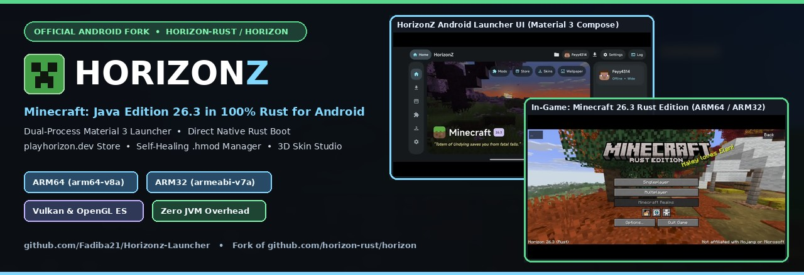
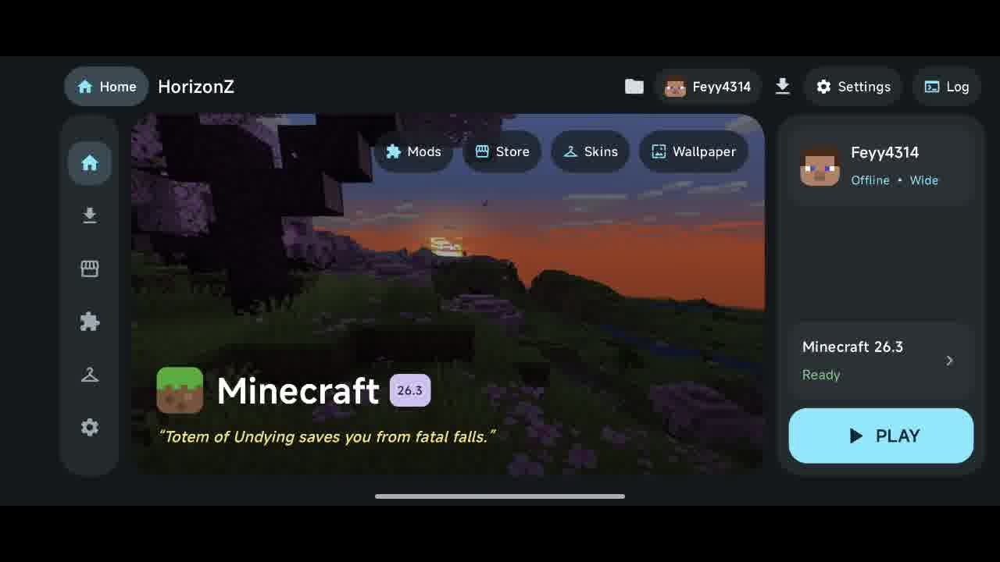
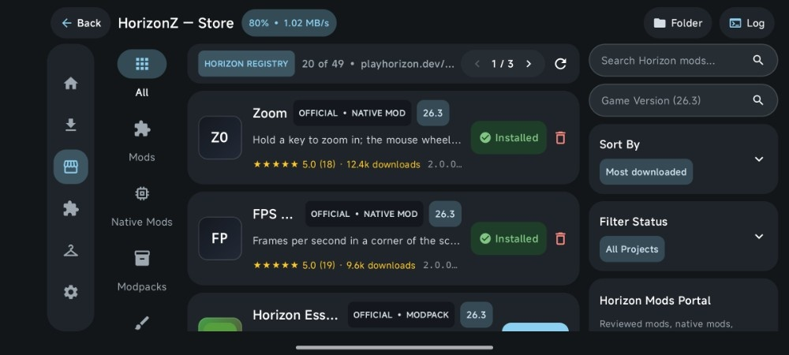
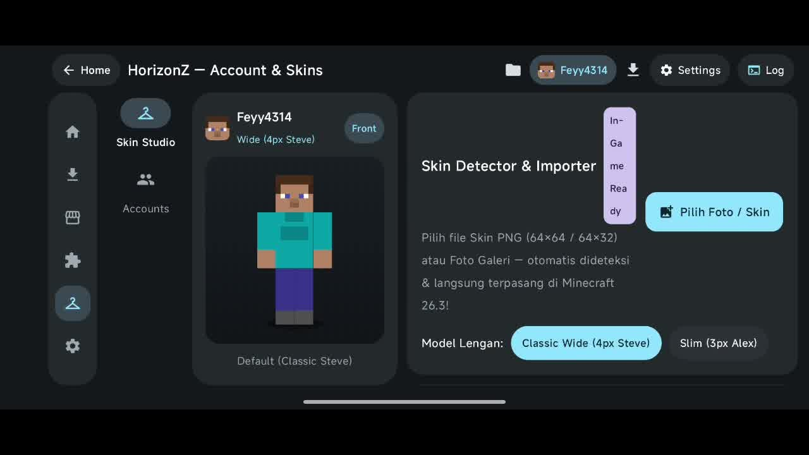
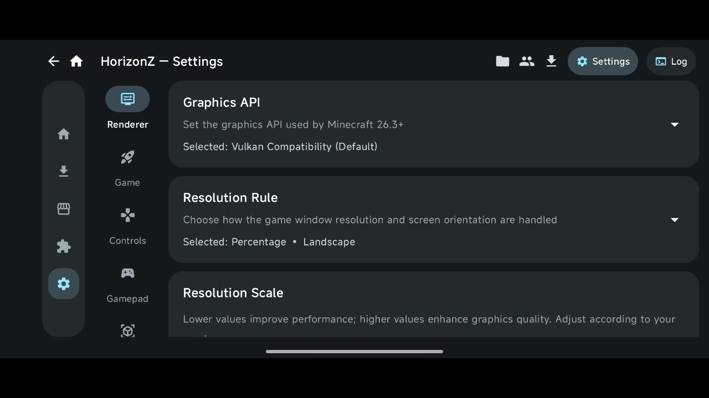

<!-- HORIZONZ_README_PRESERVE -->
<!-- HORIZONZ_README_MOBILE_V3 -->

# 🎮 HorizonZ Launcher Android

**Native Rust Minecraft 26.3 Launcher & Engine for Android (`arm64-v8a` & `armeabi-v7a`)**

<!-- VERSION_BADGE_START -->

<!-- VERSION_BADGE_END -->

<!-- LATEST_VERSION_START -->
> 🚀 **Latest Update — HorizonZ v2.1**: Integrates the bounded upstream `Vasysik/horizon-android` range `bef1eff277871f7be5bc0eed944eb76565188809...125c67284343d649b92ac5b3f9eb5a50f56328ca` (`0.7.7` candidate), pinning the upstream engine checkout to commit `125c67284343d649b92ac5b3f9eb5a50f56328ca`, staging **opt-in built-in mods (`Zoom`, `Minimap`, `Recipes`, `SmartF3`) disabled by default**, exposing **protected `Configuration` and `saves` (Worlds) access via Android Files** (blocking world access while `:game` is running and hiding account/API-key files), and refreshing version-stamped `engine-data.zip` tables while preserving all HorizonZ `v2.0` capabilities (**Google AI Studio / Gemini API Agent**, **WGSL Shader Packs**, **Random Cinematic & Trailer Player**, and **3D Skin Studio**).
<!-- LATEST_VERSION_END -->

## ✨ Key Features

- 🦀 **100% Native Rust Engine (`Minecraft 26.3`)**: Runs directly on **Vulkan** and **OpenGL ES (`wgpu`)** via `libhorizon_android.so` without Java VM garbage collection overhead (`arm64-v8a` & `armeabi-v7a`).
- 🤖 **In-Game AI Agent (`Google AI Studio / Gemini API`)**: Connects to the game's local control endpoint (`horizon-control.json` TCP `port` + `auth <TOKEN>` protocol) and an in-game `✨ AI` HUD overlay with **22+ selectable Gemini models** (`Gemini 4 Argon`, `Gemini 3.8`, `Gemini 3.5 Flash-Lite`, `Gemini 2.5`, etc.) and **100% device-local API key storage (`0600`)**.
- 🎬 **Random Cinematic & Trailer Player**: Plays a curated playlist of **Minecraft Cinematic & Official Trailers** under 5 minutes in **random shuffle** order at 720p, with captions disabled by default and a collapsible 3-dot control menu.
- 🧩 **Two-Way Store & Manager Synchronization**: Browse, download, install, and update **Mods (`.hmod` containing `mod.wasm`)**, **Native Mods (`.hnmod`)**, **Shader Packs (`.hshader`)**, **Resource Packs**, and **Modpacks (`.hpack`)** from the `playhorizon.dev/mods` catalog.
- 🧠 **Dynamic RAM Allocation**: Configure the engine memory budget (`horizon-memory.txt` & `WGPU_MEMORY_BUDGET_MB`) via a device-RAM-aware slider, defaulting to **Unlimited (OS Limit)**.
- 🎨 **Interactive 3D Skin Studio**: Live 3D character preview (360° touch rotation & walking animation), automatic **Wide (4px)** / **Slim (3px)** arm model detection, custom skin naming, and a saved skin selector.
- ⚡ **Zero-Overhead Gaming**: All launcher background threads, UI timers, and trailer `WebView` instances automatically pause or terminate when switching to the `:game` process.

## ⚙️ Architecture & Technical Overview

| Technical Component | Specification & How It Works in HorizonZ |
| :--- | :--- |
| **Process & Rendering (`:game`)** | `HorizonActivity` runs in an isolated process (`android:process=":game"`) using `NativeActivity` + `wgpu` (**Vulkan Compatibility**, **Vulkan High-Perf**, or **OpenGL ES**) with Android ADPF thermal hints. |
| **Assets & Worldgen (`26.3`)** | Downloads and verifies SHA-1/SHA-256 checksums for `client.jar`, Mojang CDN asset objects, `26.3` worldgen registries, and 60 touch control textures into `.local/horizon-client/26.3`. |
| **Mod & WGSL Shader Pipeline** | Supports executable `.hmod` WebAssembly mods (`mod.wasm`) and `.hnmod` manifests (`horizon-mods.txt` & `horizon-extras.txt`), plus automatic `.hshader` verification (`horizon-shaders.toml` `schema = 1` with `input.color`-compliant `sky.wgsl` and `post.wgsl` stages). |
| **Gemini AI Agent Bridge** | `HorizonZ-GeminiAgentBridge` connects the local `$HORIZON_CONTROL` TCP JSON-file socket (`state`, `inventory`, `looking-at`, `messages`, `chat`, `command`) and the in-game `✨ AI` command panel to `generativelanguage.googleapis.com` using the local key file `horizon-gemini-secret.json` (`0600`). |
| **Runtime Auto-Sync (`BBS/`)** | `BBS/sync_and_merge_bbs.py` tracks runtime updates from `Vasysik/horizon-android` (`v0.7.7` candidate `125c672`) and reapplies HorizonZ Rust and Android patches during the build workflow. |

## 📱 Launcher User Interface

### 🏠 1. Main Dashboard (HD Wallpapers & Random Cinematic Trailer)

### ⬇️ 2. Game & Assets Manager (Download, Smart Repair & Asset Storage)

### 🛒 3. HorizonZ Store (`playhorizon.dev/mods` Registry)

### 🧩 4. Files & Mods Manager (Mods, Saves, Resource Packs & Shaders)

### 👕 5. Account & 3D Skin Studio

### ✨ 6. Settings & AI Agent Integration (Google AI Studio / Gemini API)

## 📥 APK Download & Quick Start Guide

### 📦 HorizonZ v2.1 APK Summary
- **Target ABIs**: `HorizonZ-Launcher-2.1-arm64-v8a.apk` (64-bit ARMv8 devices) and `HorizonZ-Launcher-2.1-armeabi-v7a.apk` (32-bit ARMv7 devices).
#### What's New in v2.1
- **Pinned upstream runtime:** Uses `Vasysik/horizon-android` commit `125c67284343d649b92ac5b3f9eb5a50f56328ca` (0.7.7 candidate); a version stamp refreshes `engine-data.zip` and clears stale derived block-behaviour caches after an update.
- **Optional built-in mods:** Stages `Zoom`, `Minimap`, `Recipes`, and `SmartF3` with enable/disable controls; all are disabled by default.
- **Protected Android Files access:** Exposes `Configuration` and `saves` (Worlds), blocks save access while the game process is active, and hides account and API-key files.
- **v2.0 customizations retained:** Keeps the Gemini API Agent and in-game `✨ AI` HUD, WGSL shader packs, randomized cinematic/trailer player, and 3D Skin Studio.
### 🚀 Quick Start Steps
1. **Install the APK**: Download the APK matching your device ABI (`arm64-v8a` or `armeabi-v7a`) from the [**Releases**](https://github.com/Fadiba21/Horizonz-Launcher/releases) page.
2. **Download 26.3 Assets**: Open the **Game & Assets** tab and download the official Minecraft 26.3 assets until progress reaches **100%**.
3. **Configure AI Agent (Optional)**: Open **Settings > AI Agent**, paste your API key from [Google AI Studio](https://aistudio.google.com/apikey) (saved locally on your device), choose a model (`Gemini 4 Argon`, `Gemini 3.8`, `Gemini 3.5 Flash-Lite`, etc.), and tap the **Test Gemini Connection** button.
4. **Launch & Play**: Tap **PLAY** on the Dashboard to enter Minecraft 26.3; tap the **`✨ AI`** button at the top-left of the in-game screen or type `@ai <message>` in chat at any time to use the AI assistant.

## 📜 License & Credits

- 🔗 **Fork Repository**: [Fadiba21/Horizonz-Launcher](https://github.com/Fadiba21/Horizonz-Launcher)
- 📱 **Upstream Android Runtime**: [Vasysik/horizon-android](https://github.com/Vasysik/horizon-android) (`v0.7.7` candidate `125c672`)
- 🦀 **Core Rust Engine**: [horizon-rust/horizon](https://github.com/horizon-rust/horizon) (`Apache-2.0`)
