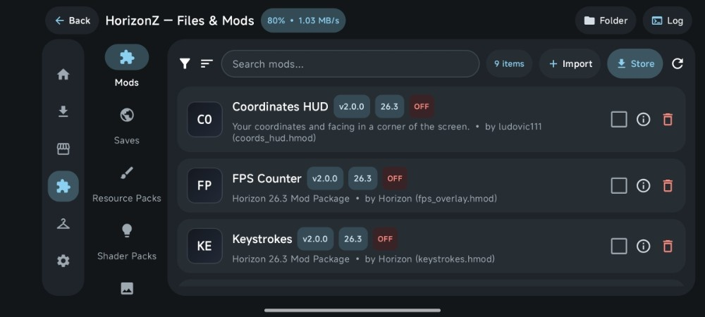
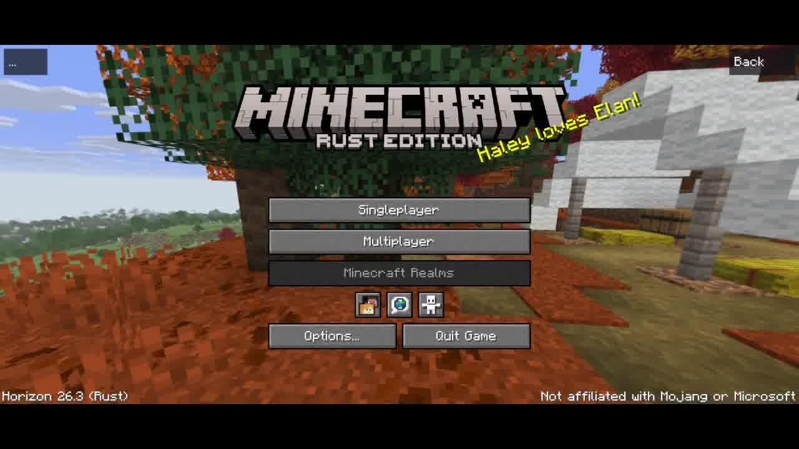
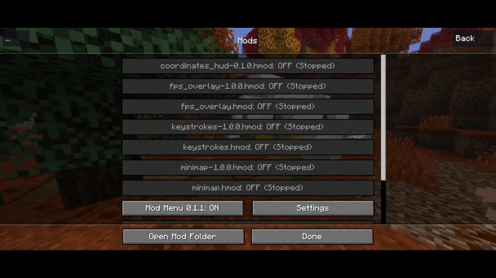

<!-- HORIZONZ_README_PRESERVE -->
<!-- HORIZONZ_README_MOBILE_V2 -->
<div align="center">


<br/>

# 🟩 HorizonZ — Android Launcher & Native Rust Runtime
### Official Android Fork of [`horizon-rust/horizon`](https://github.com/horizon-rust/horizon) • Minecraft: Java Edition `26.3` in 100% Rust

<!-- VERSION_BADGE_START -->
[](https://github.com/Fadiba21/Horizonz-Launcher/releases)
<!-- VERSION_BADGE_END -->
[-DEA584?style=for-the-badge&logo=rust&logoColor=black)](https://github.com/horizon-rust/horizon)
[-80D8FF?style=for-the-badge&logo=linux&logoColor=black)](https://github.com/Vasysik/horizon-android)
[_%7C_ARM32_(armeabi--v7a)-00897B?style=for-the-badge&logo=arm&logoColor=white)](https://github.com/Fadiba21/Horizonz-Launcher/actions)
[](https://playhorizon.dev/mods)

<p align="center">
  <b>HorizonZ Launcher</b> is a dedicated Android fork of <a href="https://github.com/horizon-rust/horizon"><b>horizon-rust/horizon</b></a> that brings <b>Minecraft: Java Edition 26.3</b>—completely rewritten from the ground up in <b>100% native Rust</b> with zero JVM overhead—to Android devices (<code>arm64-v8a</code> 64-bit &amp; <code>armeabi-v7a</code> 32-bit), paired with a modern <b>Material 3 Jetpack Compose Launcher UI</b>.
</p>

<p align="center">
  <a href="#-about-this-android-fork">About</a> •
  <a href="#-screenshots--launcher--in-game-minecraft-263">Screenshots</a> •
  <a href="#%EF%B8%8F-how-it-works--system-architecture">System Architecture</a> •
  <a href="#-key-features">Features</a> •
  <a href="#-download--installation">Installation</a> •
  <a href="#-ci--arm64--arm32-build-pipeline">Build Pipeline</a>
</p>

</div>

---

## 🚀 About This Android Fork

Unlike traditional Android Minecraft Java launchers (such as PojavLauncher or ZalithLauncher) that rely on a heavy OpenJDK Java Virtual Machine (`libjvm.so`) and GL4ES translation layers on mobile hardware, **HorizonZ Launcher** executes a **100% native Rust binary (`libhorizon_android.so`)** compiled directly for Android's **ARM64 (`aarch64-linux-android`)** and **ARM32 (`armv7-linux-androideabi`)** architectures via the Android NDK (`r28`).

This repository ([`Fadiba21/Horizonz-Launcher`](https://github.com/Fadiba21/Horizonz-Launcher)) is a full fork of [`horizon-rust/horizon`](https://github.com/horizon-rust/horizon) that integrates three unified layers into a single installable Android application:

| Layer | Technology Stack | Upstream / Reference | Responsibility |
| :--- | :--- | :--- | :--- |
| **1. Core Voxel & Protocol Engine** | 100% Rust (`wgpu`, `vulkan`, `gles`, `tokio`, `ecs`) | [`horizon-rust/horizon`](https://github.com/horizon-rust/horizon) | Native Rust implementation of **Minecraft: Java Edition 26.3** world rendering, chunk meshing, physics, audio, and multiplayer networking without a JVM. |
| **2. Android Native Runtime & Asset Installer** | Rust JNI (`android-activity`, `ndk`) + `HorizonActivity` | [`Vasysik/horizon-android`](https://github.com/Vasysik/horizon-android) (`v0.7.6`) | Bridges Android `SurfaceView`, multi-touch input, audio output, `HorizonDocumentsProvider` (SAF), and the 6-stage official Mojang 26.3 asset bootstrapper. |
| **3. HorizonZ Material 3 Frontend UI** | Kotlin + Jetpack Compose (`ZalithMainActivity`) | Inspired by [`ZalithLauncher2Plus`](https://github.com/Star1xr/ZalithLauncher2Plus) & [`playhorizon.dev`](https://playhorizon.dev/mods) | Provides the landscape Material 3 dashboard, **100% `playhorizon.dev/mods` Store**, **Files & Mods Manager**, **2D/3D Skin Studio**, **Renderer & Control Settings**, and **Background Download Service**. |

---

## 📸 Screenshots — Launcher & In-Game Minecraft 26.3

### 🖥️ HorizonZ Android Launcher Interface (Material 3 Compose)

<table>
  <tr>
    <td width="50%" align="center">
      <br/>
      <b>1. Main Dashboard</b><br/>
      <sub>Material 3 landscape dashboard with live <b>Minecraft 26.3 [RUST]</b> status, quick-access pills (Mods, Store, Skins, Wallpaper), active profile card, and one-tap <b>PLAY</b> button.</sub>
    </td>
    <td width="50%" align="center">
      <br/>
      <b>2. Integrated Horizon Store (<code>playhorizon.dev/mods</code>)</b><br/>
      <sub>Browse, search, install, and update native Rust <code>.hmod</code> mods, Resource Packs, Shaders, and Modpacks directly from the official <a href="https://playhorizon.dev/mods">Horizon Mods Registry</a>.</sub>
    </td>
  </tr>
  <tr>
    <td width="50%" align="center">
      <br/>
      <b>3. Files &amp; Mods Manager</b><br/>
      <sub>Manage installed <code>.hmod</code> packages, Worlds (<code>saves/</code>), Resource Packs, and Shaders with one-tap enable/disable toggles, metadata inspection, and safe deletion confirmation dialogs.</sub>
    </td>
    <td width="50%" align="center">
      <br/>
      <b>4. Account &amp; 2D/3D Skin Studio</b><br/>
      <sub>Interactive 2D/3D skin preview and importer supporting <code>64×64</code> and legacy <code>64×32</code> PNG skins with Classic Wide (4px Steve) and Slim (3px Alex) arm models.</sub>
    </td>
  </tr>
  <tr>
    <td colspan="2" align="center">
      <br/>
      <b>5. Renderer, Controls &amp; Engine Settings</b><br/>
      <sub>Configure Vulkan / OpenGL ES Graphics API, resolution scaling (25%–100%), max FPS limit, custom Bedrock touch controls, gamepad sensitivity, and theme colors.</sub>
    </td>
  </tr>
</table>

### 🎮 In-Game Minecraft: Rust Edition (`Horizon 26.3 Rust`) on Android

<table>
  <tr>
    <td width="50%" align="center">
      <br/>
      <b>In-Game Title Screen — <code>MINECRAFT RUST EDITION</code> (Horizon 26.3)</b><br/>
      <sub>Direct boot into the native Rust <code>libhorizon_android.so</code> engine with Singleplayer, Multiplayer, Minecraft Realms, and full touch-control HUD.</sub>
    </td>
    <td width="50%" align="center">
      <br/>
      <b>In-Game Native <code>.hmod</code> Mod Menu (<code>Mod Menu 0.1.1</code>)</b><br/>
      <sub>All <code>.hmod</code> packages installed or toggled in the HorizonZ Launcher Manager are automatically validated and loaded in-game without EOCD or missing-manifest errors.</sub>
    </td>
  </tr>
</table>

---

## ⚙️ How It Works — System Architecture

### 1. Dual-Process Android Architecture (Zero UI Overhead During Gameplay)
To maximize available RAM and GPU frame pacing on mobile devices, HorizonZ separates the Compose Launcher UI and the Rust Game Engine into two distinct OS processes in `AndroidManifest.xml`:

```text
┌──────────────────────────────────────────────────────────────────────────────┐
│  Process 1: dev.horizon.android (ZalithMainActivity — Material 3 Compose)    │
│  • Dashboard, playhorizon.dev Store, Mods/Saves Manager, 2D/3D Skin Studio   │
│  • Foreground Asset Download Service (HorizonDownloadService + Notification) │
│  • Pre-Launch Validator: Repairs .hmod archives, syncs catalog & options.txt │
│  • Pauses all animations, log pollers, & background coroutines on game start │
└──────────────────────────────────────┬───────────────────────────────────────┘
                                       │
         Intent + Direct Boot Flag (zalith-auto-launch.flag)
         + Unique Launch Token (zalith-launch-token.txt)
                                       ▼
┌──────────────────────────────────────────────────────────────────────────────┐
│  Process 2: dev.horizon.android:game (HorizonActivity — NativeActivity)      │
│  • Loads compiled Rust shared library: libhorizon_android.so                 │
│  • Reads zalith-auto-launch.flag → Bypasses internal upstream setup screen   │
│  • Boots directly into Minecraft: Rust Edition 26.3 (Vulkan / OpenGL ES)     │
│  • On "Quit Game": Writes zalith-game-exited.flag & cleanly terminates :game │
└──────────────────────────────────────────────────────────────────────────────┘
```

### 2. Six-Stage Official Minecraft `26.3` Asset Bootstrapper & Background Service
Before launching the native Rust engine for the first time, HorizonZ verifies and downloads the required official Mojang `26.3` client assets and Bedrock touch controls through `HorizonNativeBridge.ensureFullMinecraft263AssetsReady()`, backed by Android's `HorizonDownloadService` (`foregroundServiceType="dataSync"`):
1. **Stage `1/6` — Preparing Directories**: Initializes `instances/Minecraft-26.3/`, `assets/indexes/`, `assets/objects/`, `mods/`, `resourcepacks/`, `shaderpacks/`, and `saves/`.
2. **Stage `2/6` — Fetching Mojang Version Manifest**: Queries `https://piston-meta.mojang.com/mc/game/version_manifest_v2.json` to resolve the official `26.3` asset index and client JAR URLs.
3. **Stage `3/6` — Downloading Asset Index**: Saves the `26.3.json` asset index (`4,400+` game sound, language, icon, and shader objects) and writes `official-install.json` for `official_install.rs`.
4. **Stage `4/6` — Extracting Client Textures & Data**: Streams the official `26.3` `client.jar` and extracts block, item, entity, font, and GUI textures into `data/minecraft/`.
5. **Stage `5/6` — Preparing 60 Bedrock Touch Control Icons**: Extracts pre-bundled touch control PNGs from `engine-data.zip` (with automatic `raw.githubusercontent.com` and `cdn.jsdelivr.net` fallback) into `assets/mc_controls/png/`.
6. **Stage `6/6` — Downloading Sound & Pack Objects**: Downloads remaining hash-verified resource objects with an active Android status-bar notification showing live percentage (`0%–100%`), stage (`1/6–6/6`), and transfer speed (`MB/s`).

### 3. Self-Healing `.hmod` Validator & Two-Way Store/Manager Synchronization
Horizon's native Rust mod loader requires every `.hmod` archive in `mods/` to be a valid ZIP containing a top-level `horizon-mod.toml` manifest:
- **100% [`playhorizon.dev/mods`](https://playhorizon.dev/mods) Integration**: Queries `https://api.playhorizon.dev/v1/mods` with full offline catalog fallback across **Mods**, **Resource Packs**, **Shaders**, and **Modpacks**.
- **Duplicate-Free Version Upgrades**: Installing or updating a mod via `installOrReplaceHorizonStoreItem()` automatically strips version suffixes (`-0.1.0`, `_v1.2`), removes any older `.hmod` or `.hmod.disabled` file of the same mod slug, and installs the new release cleanly so duplicates never appear in the Manager or in-game.
- **Pre-Launch Archive Repair (`ensureValidHmodArchive`)**: Every `.hmod` downloaded from the Store, imported via file picker, or scanned before pressing **PLAY** is verified with `java.util.zip.ZipFile`. Corrupted downloads (`Invalid Zip archive: Could not find EOCD`) or archives missing `horizon-mod.toml` are automatically repaired in-place so every mod loads cleanly in-game.

### 4. Two-Way Engine, Keypad & `options.txt` Synchronization
Every setting adjusted in the **HorizonZ Settings** screen is synchronized with the native Rust runtime before launch and reconciled when exiting the game:
- **Renderer Backend (`catalog.rs`)**: Writes `"auto"`, `"vulkan"`, or `"open-gl"` into `selected_graphics_api` inside `launcher-catalog.json` (plus `HORIZON_GRAPHICS_API`), along with `resolution_scale_percent` (`25%–100%`) and `max_fps`.
- **Touch Controls & Gamepad (`horizon-keypad.json`)**: Syncs button scale (`50%–200%`), opacity (`10%–100%`), custom deadzone, and controller sensitivity directly with the native overlay.
- **Two-Way `options.txt` Sync**: Syncs FOV, Render Distance (`2–32 chunks`), GUI Scale, Fullscreen, VSync, Master Volume, and active Resource Packs before game start, and reads back any in-game changes made by the player in `onResume()` when returning to the launcher.

---

## ✨ Key Features

- 🦀 **100% Native Rust Engine (`26.3`)** — Powered by [`horizon-rust/horizon`](https://github.com/horizon-rust/horizon) and [`Vasysik/horizon-android`](https://github.com/Vasysik/horizon-android) (`v0.7.6`) for high FPS and low memory usage on Android.
- 🎬 **Dashboard Trailer & RAM Allocation** — Plays official `@Minecraft` YouTube trailers under five minutes, automatically hides captions, advances to the next trailer, and provides an animated three-dot menu; includes a RAM slider with **Free** and Android OS-managed limit modes.
- 📱 **Strict ARM64 & ARM32 Support** — Native builds for 64-bit (`arm64-v8a` / `aarch64-linux-android`) and 32-bit (`armeabi-v7a` / `armv7-linux-androideabi`) Android devices running Android 9.0+ (`minSdk 28`, `targetSdk 35`).
- 🛒 **Official `playhorizon.dev` Store** — Smart button states (`Installed ✓`, `Update ↑`, `Installing...`, `Cancel ✕`, `Incompatible`) synchronized in real time with the local Mods & Packs Manager.
- 🧩 **Full Files & Mods Manager** — Manage **Mods (`.hmod`)**, **Saves (Worlds)**, **Resource Packs**, and **Shader Packs** with animated slide/fade transitions and confirmation dialogs before deletion.
- 🎨 **Interactive 2D/3D Skin Studio** — Preview, rotate, and import custom `64×64` or `64×32` PNG skins from Android Gallery or Files with Steve (`4px`) and Alex (`3px`) arm models, synced directly into `launcher-catalog.json` and `data/minecraft/textures/entity/player/`.
- 🔔 **Smart Fork Release Update Detector** — Checks [`Fadiba21/Horizonz-Launcher/releases`](https://github.com/Fadiba21/Horizonz-Launcher/releases) on startup, filters specifically for HorizonZ Android `.apk` releases matching your device's CPU ABI, and always selects the highest semantic version.
- 📂 **Built-in Android File Manager Integration** — Exposes the `.minecraft` instance directory (`mods/`, `saves/`, `resourcepacks/`, `shaderpacks/`, `logs/`) directly in the system **Files** app via `HorizonDocumentsProvider`.

---

## 📥 Download & Installation

<!-- LATEST_VERSION_START -->
1. Go to the [**HorizonZ — Releases**](https://github.com/Fadiba21/Horizonz-Launcher/releases) page and download the latest **HorizonZ v1.6** APK matching your device architecture:
   - **`HorizonZ-Launcher-1.6-arm64-v8a.apk`** — Recommended for modern 64-bit Android phones and tablets.
   - **`HorizonZ-Launcher-1.6-armeabi-v7a.apk`** — For 32-bit ARMv7 Android devices.
<!-- LATEST_VERSION_END -->
2. Install the APK on your Android device (Android 9.0 Pie / API 28 or newer).
3. Open **HorizonZ**, choose or create your player profile in **Account & Skins**, and optionally install native `.hmod` mods from the **Store** tab.
4. Tap **PLAY** on the dashboard. On first launch, HorizonZ will download and verify the official Minecraft `26.3` assets (continuing safely in the background with a live progress notification if you switch apps) and boot directly into **Minecraft: Rust Edition 26.3**.

---

## 🔄 Automated `Update/` Drop-In & ARM64 / ARM32 CI Build Pipeline

This repository includes an automated GitHub Actions workflow (`.github/workflows/build-apk.yml`) that builds both **ARM 64-bit (`arm64-v8a`)** and **ARM 32-bit (`armeabi-v7a`)** release APKs:

1. **Drop-In `Update/*.zip` Auto-Extractor (`scripts/apply_update_zip.py`)**:
   - Uploading any `HorizonZ*.zip` update package into the `Update/` directory automatically extracts the updated source files over the repository root, preserves this `README.md` layout (updating only the version badges), deletes the processed `.zip` archive from `Update/`, and commits the changes to `main`.
2. **Dual-Architecture Rust NDK Compilation (`libhorizon_android.so`)**:
   - Syncs the latest [`Vasysik/horizon-android`](https://github.com/Vasysik/horizon-android) crates, applies direct-boot and touch-control patches (`scripts/patch_horizon_direct_boot.py`), pre-bundles all 60 Bedrock touch control icons (`scripts/prestage_controls_and_wallpapers.py`), and compiles `libhorizon_android.so` for `aarch64-linux-android` (`arm64-v8a`) and `armv7-linux-androideabi` (`armeabi-v7a`).
3. **Automated GitHub Release Publishing**:
   - Packages signed release APKs via Gradle (`8.10.2`), generates `SHA256SUMS.txt`, and publishes them automatically to [**GitHub Releases**](https://github.com/Fadiba21/Horizonz-Launcher/releases).

---

## 🤝 Credits & Upstream Projects

- **[Horizon (`horizon-rust/horizon`)](https://github.com/horizon-rust/horizon)** — Upstream 100% Rust rewrite of Minecraft: Java Edition `26.3`.
- **[Horizon Android (`Vasysik/horizon-android`)](https://github.com/Vasysik/horizon-android)** — Upstream Android `NativeActivity` port, JNI runtime bridge, and official asset installer.
- **[Horizon Mods Registry (`playhorizon.dev/mods`)](https://playhorizon.dev/mods)** — Official community registry for native Horizon `.hmod` packages, Resource Packs, Shaders, and Modpacks.
- **[ZalithLauncher2Plus (`Star1xr/ZalithLauncher2Plus`)](https://github.com/Star1xr/ZalithLauncher2Plus)** — UI layout inspiration for the Material 3 landscape dashboard and file manager cards.

> **Disclaimer**: HorizonZ Launcher is an independent open-source project and is **not affiliated with, endorsed by, or associated with Mojang Studios or Microsoft Corporation**. Official Minecraft game assets are downloaded directly from Mojang's official servers (`piston-meta.mojang.com` / `resources.download.minecraft.net`) on your device during initial setup.
